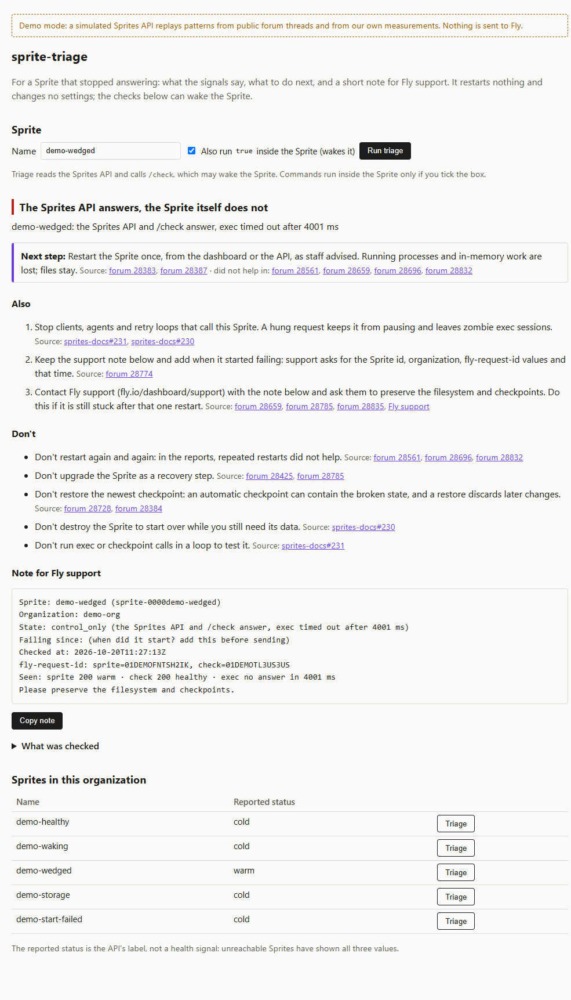
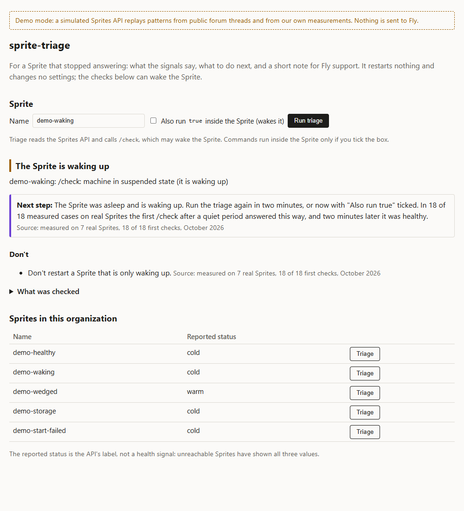

# sprite-triage

When a Sprite stops answering, sprite-triage checks the few signals the API offers, says what they point to, lists the next steps that helped in public forum threads (and the ones that made things worse), and writes the short note Fly support asks for. It restarts nothing and changes no settings; its checks can wake a sleeping Sprite, and it says when they did. It has a small Phoenix LiveView page for people and a command line (text or JSON) for scripts and agents.

## Why

Between July and October 2026 the Fly.io community forum collected more than fifteen threads about stuck Sprites ([cases](docs/cases.md)). They go the same way: `GET /v1/sprites/{name}` works, but exec, console and checkpoints hang or fail with `i/o timeout` or `Storage not ready`; people try restarts, upgrades and waiting, often in loops; then support asks for the Sprite id, the organization, `fly-request-id` values and the time it started failing, piece by piece. One user asked for "the right set of steps for us to perform" ([28835](https://community.fly.io/t/28835)).

Only Fly can fix the host side. A tool can shorten the way there and keep people and agents from making things worse.

## Try it without an account

```sh
docker build -t sprite-triage-demo . && docker run --rm -p 127.0.0.1:4090:4090 sprite-triage-demo
```

Then open http://localhost:4090/. With Elixir 1.18+ installed, `mix deps.get && mix sprite_triage.demo` does the same. A simulated API replays five patterns: `demo-healthy`, `demo-waking` (the first wake after a quiet period, see below), `demo-wedged` (healthy `/check`, but a command inside hangs; tick "Also run true" to see it), `demo-storage` and `demo-start-failed`. The image runs on Fly.io as it is; `fly.toml` lists the three commands.



## Use it

```sh
export SPRITES_TOKEN=...
mix sprite_triage my-sprite            # text
mix sprite_triage my-sprite --json     # for scripts and agents
mix sprite_triage my-sprite --wake     # also run `true` inside the Sprite
SPRITE_TRIAGE_SERVER=true mix run --no-halt   # the page; prints its address with a key
```

Exit codes: 0 healthy, 1 not healthy (including waking), 2 usage, token or name problem. The page uses your token, so it listens on 127.0.0.1 and needs a key that it prints at start; the live connection checks the key again, because cookies are shared between all ports of `localhost`.

## What it checks

| Probe | When | Effect on the Sprite |
|---|---|---|
| `GET /v1/sprites/{name}` | always | none |
| `GET /v1/sprites/{name}/check` | by default | may wake it; reports `failed to start machine` or `Storage not ready` |
| one exec of `true` | only with `--wake` or the checkbox | wakes it; run once, never retried |

The HTTP probes run in parallel with deadlines (15 s, 60 s); the exec gets 45 s. A probe that runs over is killed. The exec command belongs to a guard process that kills it at the deadline, even if the SDK hands it over late. Nothing is retried.

| State | Meaning | Next step |
|---|---|---|
| `ok` | `/check` healthy (and the command ran, if asked) | if commands still hang, run it with `--wake` |
| `waking` | `/check` says "machine in suspended state" | run it again in two minutes |
| `control_only` | the API answers, the Sprite does not | one restart, as staff advised; then support |
| `start_failed` | `/check`: failed to start | support; restarts failed in both reports |
| `storage_not_ready` | "Storage not ready" | support; only Fly fixed it |
| `unknown_network` | the API did not answer | check your network and the status page |
| `unknown`, `auth_error`, `not_found` | contradicting signals, token or name | as shown |

The reported status (`running`, `warm`, `cold`) is shown but never used: stuck Sprites were reported with each of the three, and a healthy one as `cold`. Every step on the page names the thread it comes from and where it did not help.

## Measured on real Sprites

On 20 October 2026 the tool ran against real Sprites in a trial organization:

- 26 triages of fresh Sprites: all healthy.
- After 15 quiet minutes, the first `/check` answered HTTP 200 with `{"status": "needs_repair", "reason": "machine in suspended state"}` in 18 of 18 cases on seven Sprites, while `true` inside ran fine (in 0.9 to 11 s). Two minutes later all 18 were healthy, and a small HTTP app with a background worker on one of them kept running without a restart. The first version reported these as `unknown` with a support note: 18 false alarms. They are now `waking` without `--wake`, and `ok` with it. This answer is not in the Sprites docs, the OpenAPI spec or the Elixir SDK.
- Separately, a process holding a random value in memory survived a 30-minute pause with the same PID and boot id, while three other Sprites were reported `cold` without pausing at all. So `cold` says neither that a Sprite paused nor that its memory is gone.

The raw results stay private because they contain account details.



## Limits

- It has not met a really stuck Sprite. Those cannot be made on purpose; the rules come from public threads, and the deadlines are estimates from them.
- `/check` is not in the public OpenAPI or the Elixir SDK; it comes from the official JS SDK and staff answers. Its full set of answers is not documented.
- The browser side of the access key is checked by hand, not by the test suite.
- `mix deps.get` reports advisories for cowlib 2.19 and gun 2.5, which the Sprites Elixir SDK pins. They concern cookie, Link and structured-header encoding; sprite-triage sends no cookies and builds no such headers. One of them (CVE-2026-43966) has no fixed release yet.

## How it is tested

`mix test` takes about 15 seconds. The classifier is checked against cases rebuilt from the forum threads and the answers measured above; the probes run against stubbed HTTP with real tasks and deadlines; the page is tested state by state. Before a release `scripts/verify.sh` (Docker, about 15 minutes) also fails on any warning, runs the tests three times in random order, breaks rules one at a time to see that a named test catches each ([scripts/mutants.exs](scripts/mutants.exs)), and builds and starts the demo image.

## What was cut, and why

- A restart button. It took several review rounds to make safe against double restarts. The real runs showed that the most common finding, a Sprite waking up, needs no restart, and a triage tool should read, not act. The advice now says when one restart is worth a try, and the person does it.
- A local log for "failing since". It only knew this machine, so it put a guess into a note for support. The note now asks the person.
- HTTP retries. A stuck Sprite gets one request per probe; a hung call can keep it busy (sprites-docs#231).

## Code

```
lib/sprite_triage/classify.ex     observations -> state (pure)
lib/sprite_triage/advice.ex       state -> do / don't, with sources (pure)
lib/sprite_triage/note.ex         support note and its age (pure)
lib/sprite_triage/probe.ex        probes with deadlines
lib/sprite_triage/exec.ex         the optional exec, owned by a guard process
lib/sprite_triage/api.ex          HTTP calls, fly-request-id, no retries
lib/sprite_triage/cli.ex          the command line as a function
lib/sprite_triage/demo.ex         the simulated API
lib/sprite_triage_web/            the page and its access key
```

Built with coding agents: Claude Code wrote most of the code, Codex reviewed it independently. I picked the problem from the forum data, set the rules and the checks, ran it against real Sprites and decided what to cut, including an earlier restart button.
